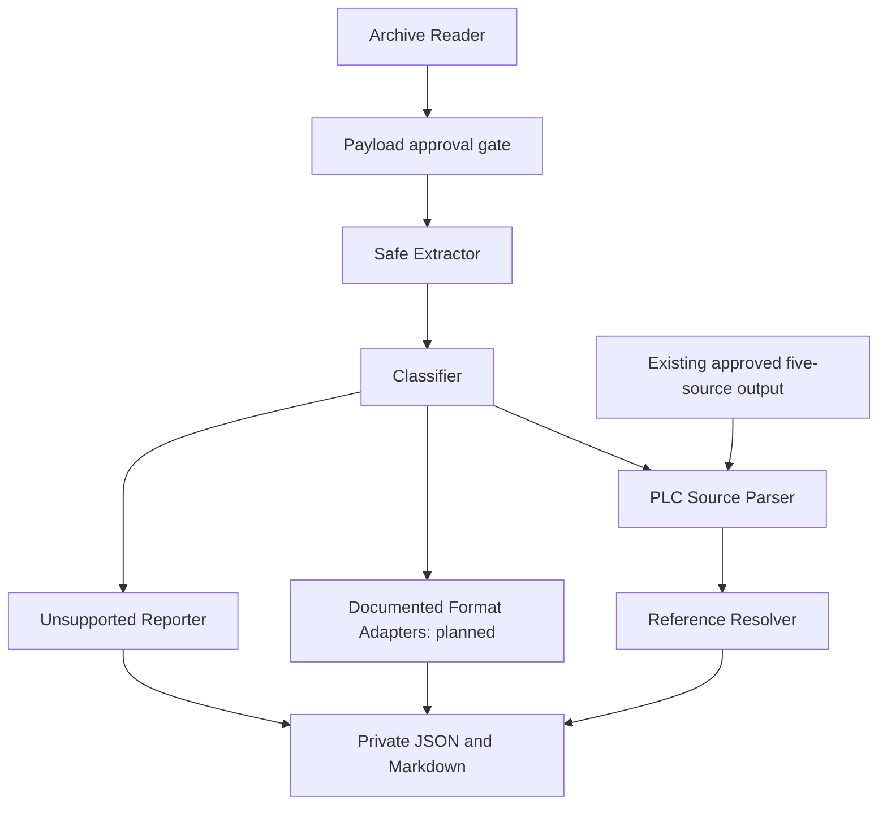

# Offline format-adapter plan

This document is a plan, not a claim of proprietary binary decoding. The current
stage reads only five previously approved extracted sources and authorized
metadata/reports/documentation. It does not open or stat excluded payloads, open
archives, launch Siemens applications, connect to controllers, or install tools.

## Evidence register

Evidence levels: **verified local result**, **documented capability**, **filename
hypothesis**, and **unknown**. A documented export option is not a tested adapter.
Installed software is not proof that its SDK/API is installed in this repository.

| Evidence | What is established | What is not established |
| --- | --- | --- |
| Existing approved batch manifest | A selected ZIP was copied with integrity checks; five source files are readable | All proprietary contents, version compatibility or project completeness |
| Five-source analysis | A bounded STEP 7-style lexical subset and exact declaration-based reference evidence | Compilation, execution, controller-loaded logic or hardware mapping |
| Authorized member metadata | Source/project-like, database/index-like and generic configuration extensions coexist | A database schema, PLC bytecode layout, NC/drive/HMI semantics or actual export version |
| Installed STEP 7 readme, “Programs for Archiving and Retrieving Files” | Standard ZIP archive/retrieval is documented | A repository API to export compiled blocks or decode the project database |
| STEP 7 getting-started manual, s7gs___b.pdf, PDF pages 54/56 | Archive and Print commands are described | A safe, verified automated block-to-source export workflow |
| S7-SCL V5.3 for S7-300/400, A5E00324650-01, s7scl__b.pdf, PDF pages 16/60 | ASCII source import/export and standard-editor source creation are documented | Recovery of original SCL from arbitrary compiled blocks; a compiled STL view is not guaranteed equivalent editable source |
| SINUMERIK Universal Operating Manual, 12/2019, 6FC5398-6AP40-6BA2, PDF pages 350/351/364 | Binary and punched-tape archives are described; punched-tape is recommended for external processing | Identification of this ZIP as such an archive, its binary grammar or a verified offline decoder |
| Earlier installation inventory | STEP 7 V5.7 SP3, Commissioning 4.8.4, SinuTrain and TIA installations were recorded | A working license, export API, repository SDK integration or permission to launch them |

These facts were checked against previously authorized local documentation
evidence records, not by querying a controller or uploading project material.
The S7-SCL manual is V5.3 evidence; it is not proof that all V5.7 SP3 behavior is
identical. Commissioning ATW documentation yielded no applicable archive API.
Compiled help and detailed drive/HMI export documentation remain unverified.

Authorized metadata suggests the following intake groups; no excluded file was
opened or statted to create this table:

| Metadata/document clue | Plausible intake group | Evidence boundary |
| --- | --- | --- |
| .awl / .scl / .src | PLC source-text candidates | Only the five already approved readable files have payload evidence; other source-like extensions remain hypotheses |
| .s7p / .s7s | Classic STEP 7 project/descriptor candidates | Names are clues, not proof of valid project structure or supported version |
| .dbf / .dbt / .mdx | Project database/index candidates | No header, schema, bytecode or proprietary mapping was inspected/decoded |
| .ini / .xml / .csv | Generic configuration/structured-text candidates | Neither HMI nor drive semantics follows from these extensions |
| .dat / .compressed / .pg and other opaque extensions | Unsupported/project-resource candidates | Codec, nesting, meaning and version remain unknown |
| Binary/punched-tape archive options in the SINUMERIK manual | Possible future NC/archive-text intake | Documentary capability only; not identification of an excluded payload |

Drive and HMI adapters are documentation-discovery candidates, not identified
formats in the excluded data. The reviewed evidence cannot justify a specific
drive/HMI export command or schema yet.

## Architecture and approval gates

The current stage follows the existing-output branch only. Generic ZIP reading,
approval-gated copying, bounded classification, source parsing and private
reporting exist. No speculative binary adapter is implemented. Reader/extractor
access is not implied by running a source parser. All unknown inputs route to an
unsupported report using authorized metadata only until further reads are approved.

Shared private output contract:

- Adapter identity/version, input evidence level and independently verified
  format/version; never infer a version from an extension alone.
- Generated source ID, source locations, optional explicit declarations/records,
  and reference relationships with confidence and resolution reason.
- Separate block-target, member-identity and absolute-address evidence. An
  unresolved reference never proves that implementation is missing.
- Diagnostics/unsupported constructs, validation outcomes, input integrity and
  limits applied. Machine names, hashes, addresses and local paths remain private.
- Stable schema and deterministic JSON/Markdown; public output is counts only.

Shared operating envelope: standard library first, read-only local copies,
no evaluation or rendering of active content, no external entity/URL resolution,
no nested processing without approval, confined generated report names, fresh
ignored output directories and immutable inputs. Default source/text research
budget is five inputs, 64 KiB each, 256 KiB aggregate, 256 MiB worker committed
memory and ten seconds. A larger or different envelope needs a reviewed bounded
preflight and explicit approval; batch-copy limits are not automatic parser limits.

## Proposed adapters

### A. Existing STEP 7-style text parser/reference resolver

- **State/evidence:** implemented limited lexical analysis, verified on synthetic
  fixtures and the five authorized sources. S7-SCL ASCII source concepts have
  local documentary support. This is not a full S7-SCL/STL compiler.
- **Versions:** only the tested syntax subset; no general project/CPU/version
  compatibility promise. Manual evidence is S7-SCL V5.3, not a binary format spec.
- **Limits/input:** current five approved sources; shared 64 KiB/256 KiB envelope,
  strict UTF-8 or BOM-marked UTF-8/16/32; no archive/project loading.
- **Output:** declarations, field evidence, occurrences, unique edges, qualified
  DB inventory, unresolved-reference ledger and separate metric definitions.
- **Validation:** synthetic grammar/ambiguity tests, CRC/size and before/after
  hashes, determinism, forbidden-read guards and confined reports.
- **Unknowns/gate:** complete grammar, indirect calls, layout, external symbols
  and runtime behavior remain unknown. Additional source files need approval.

### B. Classic STEP 7 project to documented text export bridge

- **State/evidence:** proposed only. Metadata suggests project descriptors and
  database/index files; the installed readme documents ZIP archiving, and the
  S7-SCL manual documents ASCII import/export. No database/bytecode decoder exists.
- **Versions:** none validated for the bridge. An installed V5.7 SP3 environment
  is a candidate for documentation review, not a certified adapter version.
- **Input/limits:** initially documentation and project metadata only. Any later
  project-open/export trial needs a dedicated disposable copy, exact product
  version, explicit file/byte/time budgets and separate user approval.
- **Output:** provenance-tagged exported text passed to adapter A; export warnings,
  package/version requirements and unsupported blocks remain explicit.
- **Validation:** official workflow/API documentation first, synthetic/non-machine
  export fixtures and independent text comparisons before real project access.
- **Unknowns/gate:** exact block-to-source command/API, optional packages,
  compiled-code fidelity, symbol availability and project side effects. Never
  reconstruct SCL or machine logic from filenames or a presumed DBF schema.

### C. SINUMERIK documented text/punched-tape reader

- **State/evidence:** proposed. The 12/2019 Universal manual documents punched-
  tape and binary archive options; its external-processing recommendation does
  not provide a verified parser grammar. No such payload was inspected here.
- **Versions:** none validated. The manual's product/edition is evidence only;
  no Power Line/Solution Line/828D/ONE universal compatibility claim is made.
- **Input/limits:** start with documentation and sanitized synthetic fixtures;
  later one explicitly approved text export, <=64 KiB, under the shared limits.
- **Output:** only documented section boundaries and explicit records with source
  ranges; unknown directives are retained, not interpreted as machine behavior.
- **Validation:** exact grammar/manual mapping, boundary/truncation and encoding
  tests, immutable input checks and independent known-good fixture comparisons.
- **Unknowns/gate:** binary archive layout, exact text dialect, NC/PLC/drive/HMI
  partitioning and compensation semantics. New payload access/export/tool use
  needs a separate bounded approval. No controller transfer or restore is allowed.

### D. Drive parameter text export adapter

- **State/evidence:** candidate only. Drive-related names or installed tools
  establish neither a payload format nor a working offline export capability.
  No official drive export grammar/command was verified in the reviewed evidence.
- **Versions:** none supported or verified. Product, firmware and tool version
  must be established from documentation before proposing a specific parser.
- **Input/limits:** documentation-only now; subsequently one approved documented
  text/CSV/XML export, <=64 KiB, no DTD/entities or binary parameter decoding.
- **Output:** explicit parameter identifier/value/unit records with provenance,
  keeping missing units/scaling unknown. No tuning or operating advice inferred.
- **Validation:** official schema/format documentation and synthetic fixtures,
  strict bounds, negative tests and known-good exported-text comparisons.
- **Unknowns/gate:** exact export tool, format/schema, scaling and version mapping.
  Tool launch or any excluded payload read requires separate approval. No adapter
  code is implemented until those prerequisites are met.

### E. HMI/configuration text or structured-export adapter

- **State/evidence:** candidate only. Generic INI/XML/CSV metadata is not proof
  of HMI content. No HMI export command/schema was verified in the allowed evidence.
- **Versions:** none supported; no claim for WinCC/TIA/Operate project binaries.
- **Input/limits:** current metadata/docs only; later one separately approved
  documented text export <=64 KiB, strict entity/URL rejection and inert output.
- **Output:** documented tags/messages/configuration records and unresolved
  associations; never assume PLC address meanings from tag or screen names.
- **Validation:** schema/version evidence, synthetic malformed/hostile XML cases,
  deterministic record comparisons and immutable inputs.
- **Unknowns/gate:** owning product, supported export route, tag mappings and
  project semantics. No other extracted XML/text files may be inspected under
  the present authorization, even if the generic classifier recognizes them.

### F. TIA or other proprietary project-package intake

- **State/evidence:** documentation-discovery placeholder, not an adapter. An
  installed Portal or exposed connector does not establish a verified export SDK.
- **Versions:** none certified. No repository Siemens SDK is installed/verified.
- **Input/limits:** documentation and authorized metadata only. A future bounded
  trial would name one exact version and one disposable non-machine project.
- **Output:** first an export-capability/evidence report; actual exported records
  only after independent validation, with the shared private schema.
- **Validation:** official version-specific export/API docs, dependency/license
  checks without installation, synthetic trials and negative tests before data use.
- **Unknowns/gate:** package internals, schema and exact offline automation API.
  No package reads, decompression, software launch or SDK installation is implied.

## Recommended bounded next step

First review the remaining private source-level diagnostics and unavailable
targets. Keep the three unestablished DB member identities and all absolute
offsets explicitly unknown. A documentation-only capability review of adapter B
is a possible next scope; opening projects or additional payloads would still
need a sanitized count/size/risk/destination preflight and separate explicit
approval. Do not treat this plan as permission or as completed decoding work.
